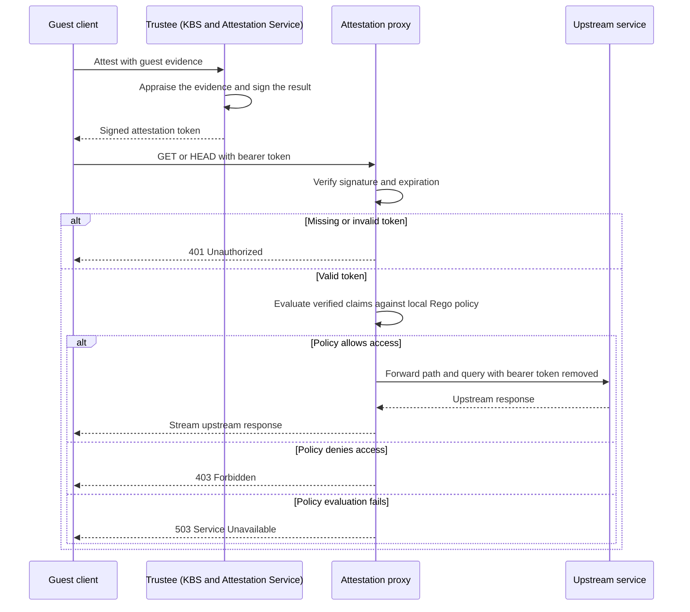

# Attestation Proxy

`attestation-proxy` is a small demonstration reverse proxy that permits `GET`
and `HEAD` requests only when they carry a Trustee attestation results token
that is valid and satisfies a local appraisal policy.



The proxy has one fixed upstream. It verifies the token using the existing KBS
token verifier, evaluates the verified claims with Trustee's Rego policy engine,
removes the bearer token, and forwards authorized requests to the configured
upstream. The example policy requires an affirming EAR appraisal. Pingora provides the HTTP
proxying, response streaming, connection pooling, upstream TLS verification,
timeouts, and graceful shutdown behavior.


## End-to-end test

From the workspace root, with the native build dependencies for KBS and the
proxy installed, run the test with live progress output.

```sh
cargo test -p attestation-proxy --test e2e_test -- --nocapture
```

The [integration test](./tests/e2e_test.rs) starts KBS with its built-in
Attestation Service and RVPS, the proxy, and an HTTP echo server on loopback.
Once all three services are healthy, it calls `kbs_client::attestation` to obtain
a signed sample EAR on an ordinary machine. It sends the token to the proxy
and checks that the echo server receives the original path and query with the
bearer credential removed. Requests with missing or invalid credentials must
return `401`, and only the authorized request may reach the echo server.

The test selects the [KBS affirming policy](../../kbs/sample_policies/affirming.rego), trusts the
public signing fixture, and installs the sample CPU appraisal policy in a
temporary KBS storage directory. It shuts down the services after the test.
Run `cargo test -p attestation-proxy` to include the verifier unit tests.

## Configuration

The proxy reads a TOML file selected by `--config`. See
[`config.example.toml`](./config.example.toml) for a complete example. Relative
file paths are resolved from the process's working directory, not from the
configuration file's directory. Files must be accessible inside the container
if the proxy runs in one. The proxy ignores unknown fields in `[attestation]`,
as KBS does. It rejects unknown fields at the top level and in `[tls]` and `[policy]`.

### Listener and upstream

These options belong at the top of the TOML file, before any `[section]` header.

| Option | Default | Purpose |
| --- | --- | --- |
| `listen_address` | `"127.0.0.1:8081"` | Address and port where clients connect to the proxy. Loopback accepts connections only from the same host or network namespace. |
| `upstream_url` | Required | Fixed backend server, for example `"http://127.0.0.1:8080"`. Only `http` or `https`, a host, and an optional port are allowed; do not include a path other than `/`, credentials, query, or fragment. |
| `upstream_timeout_seconds` | `30` | Timeout applied to upstream connection establishment, reads, and writes. This is not a total request-duration limit. Must be greater than zero. |
| `max_token_bytes` | `65536` (64 KiB) | Maximum size of the bearer token before JWT verification, excluding the `Bearer ` prefix. Limits memory and CPU spent processing oversized tokens. Must be greater than zero; Pingora's HTTP header limits also apply. |

For example, with `upstream_url = "http://127.0.0.1:8080"`, an authorized
`GET /example?name=value` is forwarded to that backend with the same path and
query. The bearer token is removed, and Pingora streams the backend response
back to the client. The upstream hostname is resolved once at startup, and the
first returned address is used until the proxy restarts.

### HTTPS listener: `[tls]`

Omit this section to listen using plain HTTP. Set both options to terminate
HTTPS in the proxy using OpenSSL:

```toml
[tls]
certificate_path = "/etc/attestation-proxy/tls.crt"
private_key_path = "/etc/attestation-proxy/tls.key"
```

| Option | Purpose |
| --- | --- |
| `certificate_path` | PEM server certificate chain presented to clients connecting to the proxy. |
| `private_key_path` | PEM private key corresponding to the listener certificate. |

These settings protect the client-to-proxy connection. The scheme in
`upstream_url` independently selects HTTP or HTTPS for the proxy-to-server
connection; HTTPS upstreams use the system trust store.

### Token-signing trust: `[attestation]`

An EAR (EAT Attestation Results) token is the signed result that Trustee's
Attestation Service issues after appraising a machine's evidence. The proxy
first authenticates the token's signing key and verifies the JWT signature and
expiration, then checks the claims described below. See the
[Attestation Service documentation](../../attestation-service/README.md) for
details of token issuance.

| Option | Default | Purpose |
| --- | --- | --- |
| `trusted_certs_paths` | `[]` | Paths to PEM files containing trusted token-signing CA certificates. For a token with a header-embedded `jwk`, KBS verifies that the key matches its `x5c` certificate chain and that the chain leads to a configured trust anchor. |
| `trusted_jwk_sets` | `[]` | Trusted JSON Web Key Set sources used to resolve signing keys for tokens with a `kid` (key ID). Supports local paths, `file://` URLs, and HTTPS JWKS sources or issuer URLs supporting OpenID discovery. |
| `insecure_header_jwk` | `false` | When `true`, skips certificate-chain endorsement of a header-embedded signing key, while still checking the JWT signature. An attacker can supply their own key and forge acceptable claims; use only for local experiments. Does not bypass `kid` lookup in configured JWKS sources. |
| `extra_teekey_paths` | `[]` | Additional JSON Pointer paths used by KBS when extracting a TEE public key from token claims. Accepted for compatibility with the KBS verifier configuration; this proxy does not extract that key, so this option currently has no effect on authorization or replay protection. |

`trusted_certs_paths` establishes trust in the **Attestation Service token
issuer**. It is separate from the `[tls]` listener certificate and the system
CA certificates used for upstream HTTPS. The proxy needs public CA
certificates, not the AS signing private key.

The example's `/etc/attestation-proxy/trustee-token-ca.pem` is a placeholder:
replace it with an existing CA certificate that endorses your AS signing
certificate. The AS must issue tokens with the matching signing key and
certificate chain. Startup fails if a configured certificate cannot be read or
parsed. With `insecure_header_jwk = false`, configure at least one usable
certificate or JWKS trust source. See
[KBS token verification](../../kbs/docs/attestation_token_verification.md) for
signing-certificate setup and JWKS details.

### Authorization policy: `[policy]`

After authenticating the token, the proxy passes its verified JSON claims as
Rego `input` to Trustee's existing `policy-engine` crate. This is the same
engine used by KBS. The proxy evaluates `data.policy.allow` and forwards only
when the result is the boolean `true`. False, missing, or non-boolean results
return `403`. Invalid or expired tokens return `401` before policy evaluation;
evaluation errors return `503` and the request is blocked.

```toml
[policy]
path = "tools/attestation-proxy/policy.rego"
```

| Option | Default | Purpose |
| --- | --- | --- |
| `path` | Required | Path to the Rego policy, relative to the process's working directory. In a container, use the mounted path, for example `/etc/attestation-proxy/policy.rego`. |

The policy is loaded into in-memory storage and checked for valid Rego syntax
at startup. An unreadable or syntactically invalid policy prevents startup.
Restart the proxy to load policy changes; recompilation is unnecessary.

The example [`policy.rego`](./policy.rego) requires the expected Trustee issuer
and EAR profile, a primary `cpu0` appraisal with TEE type `tdx` or `snp`,
affirming status in every submodule, and AS policy ID `default` in at least one
submodule. Missing statuses and malformed claims deny authorization. Edit
these rules to match your deployment. This proxy authorization policy uses the
signed AS appraisal; the AS separately applies its own evidence appraisal policy.

